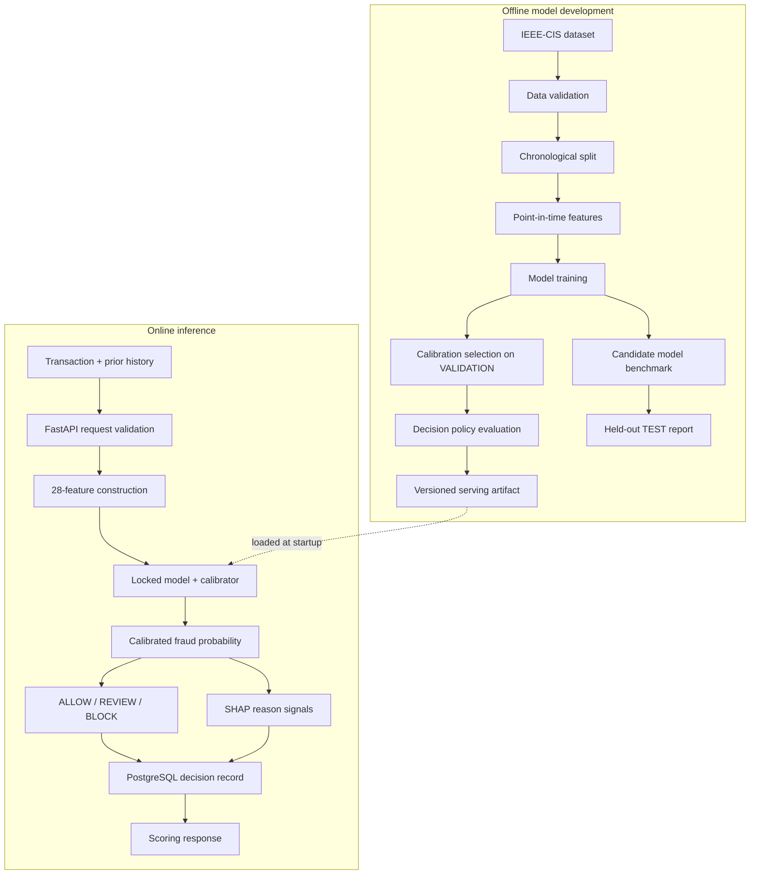
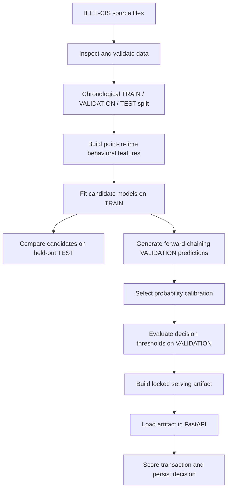

# RiskForge

[](https://github.com/Sujeet-Kona/RiskForge/actions/workflows/ci.yml)

**Fraud-risk modeling and transaction decisioning pipeline** built with Python, scikit-learn, XGBoost, FastAPI, and PostgreSQL.

RiskForge uses the IEEE-CIS Fraud Detection dataset to develop and evaluate a transaction-risk model. It builds time-aware behavioral features, compares candidate models, calibrates predicted probabilities, applies a defined decision policy, and serves decisions through an API with local explanations and database audit records.

> **Project scope:** RiskForge is an ML engineering and research project using a public historical dataset. It is not a deployed payment-network fraud system. Its benchmark results do not represent live transaction performance.

---

## 1. System overview

RiskForge separates offline model development from online transaction scoring.

- **Offline:** data validation, chronological splitting, feature construction, model training, calibration, policy evaluation, benchmarking, and serving-artifact creation.
- **Online:** request validation, feature construction, model inference, calibrated risk scoring, decision selection, explanation generation, and PostgreSQL persistence.

The API loads a previously built serving artifact. It does not train, calibrate, or tune a model while handling a transaction.

## 2. Architecture



### Main components

| Component | Responsibility |
|---|---|
| Data and split pipeline | Validate source data and create chronological partitions |
| Behavioral features | Build transaction-history features using strictly earlier events |
| Model pipeline | Preprocessing and fraud-probability estimation |
| Calibration | Convert model scores into calibrated probabilities |
| Decision policy | Map probability bands to ALLOW, REVIEW, or BLOCK |
| Explanation layer | Produce model-signal reason codes and a separate policy explanation |
| FastAPI service | Validate requests and orchestrate inference |
| PostgreSQL | Persist scoring decisions and associated metadata |
| MLflow | Track offline experiments; it is not in the request-time scoring path |

## 3. End-to-end workflow



The TEST partition is used for final reporting, not for fitting preprocessing, model parameters, calibration, or policy thresholds.

## 4. Temporal features and leakage control

Fraud-risk features often depend on previous activity. A feature calculation that accidentally includes future transactions would produce misleading evaluation results.

RiskForge applies these constraints:

- Historical features use transactions strictly earlier than the transaction being scored.
- Transactions with equal timestamps do not use one another as prior history.
- Chronological partitions keep equal `TransactionDT` values together.
- Preprocessing and estimators are fitted on TRAIN.
- Calibration and decision-policy research use VALIDATION.
- TEST is held back for final model and benchmark reporting.

The serving API expects the caller to provide the relevant prior history. It does not maintain or independently verify a complete transaction-history stream.

## 5. Model evaluation

The modeling frame contains 590,540 transactions and 28 features.

| Partition | Rows |
|---|---:|
| TRAIN | 414,446 |
| VALIDATION | 88,013 |
| TEST | 88,081 |

### Candidate model comparison

All candidates use the same chronological split and feature contract.

| Model | Average Precision | ROC-AUC | Brier score | Log loss |
|---|---:|---:|---:|---:|
| Logistic Regression | 0.145789 | 0.780255 | 0.178173 | 0.538330 |
| Random Forest | 0.426033 | 0.861220 | **0.077925** | **0.296063** |
| XGBoost | **0.449254** | **0.865318** | 0.101228 | 0.344462 |

Average Precision is emphasized because fraud is the minority class. XGBoost had the highest TEST Average Precision and ROC-AUC in this benchmark; Random Forest had better Brier score and log loss before calibration.

A paired, class-stratified bootstrap with 500 replicates estimated the XGBoost-minus-Random-Forest differences as:

| Metric | Difference | 95% interval |
|---|---:|---:|
| Average Precision | +0.023220 | +0.015090 to +0.030551 |
| ROC-AUC | +0.004098 | +0.001328 to +0.007241 |

These intervals describe resampling uncertainty within this TEST holdout. They do not account for temporal dependence, dataset shift, retraining variability, or threshold-selection uncertainty.

See [model evaluation](docs/model-evaluation.md) for calibration results, subgroup analysis, policy research, and interpretation limits.

## 6. Probability calibration and decision policy

Calibration and decisioning are separate stages.

1. The model estimates a fraud score.
2. The selected calibrator maps the score to a probability.
3. The decision policy maps that probability to an action.

Isotonic calibration was selected using forward-chaining VALIDATION predictions and Brier score as the selection criterion. It improved the selected probability-quality criterion, but slightly reduced ranking metrics on TEST. It did not outperform every alternative on every metric.

The active serving policy is `policy-001`:

| Action | Calibrated probability |
|---|---|
| ALLOW | below 0.075 |
| REVIEW | 0.075 to below 0.110 |
| BLOCK | 0.110 or above |

Policy costs and review-effectiveness assumptions are synthetic project inputs, not measured payment-network operating costs. A separately evaluated candidate policy has not been promoted to serving.

## 7. Inference and audit flow

For each scoring request:

1. FastAPI validates the transaction and supplied history.
2. The feature layer constructs the shared 28-feature input.
3. The loaded artifact produces a model score and calibrated probability.
4. The frozen policy selects ALLOW, REVIEW, or BLOCK.
5. The explanation layer returns model-signal reason codes and a separate policy explanation.
6. The service writes the decision record to PostgreSQL before returning success.

### API surface

| Method | Path | Purpose |
|---|---|---|
| GET | `/health` | Service and dependency health |
| POST | `/v1/risk/score` | Score one transaction using supplied prior history |

The interactive API schema is available at `/docs` when the service is running locally.

### Explanation boundary

SHAP values describe contributions to the model output; they are not causal explanations. The policy explanation describes which probability threshold band produced the action. These are returned as distinct pieces of information.

## 8. Technology stack

| Area | Technology |
|---|---|
| Language | Python 3.12 |
| Data processing | pandas, NumPy |
| Machine learning | scikit-learn, XGBoost |
| Calibration and metrics | scikit-learn |
| Explainability | SHAP |
| API | FastAPI, Pydantic, Uvicorn |
| Database | PostgreSQL 17, SQLAlchemy, Alembic |
| Experiment tracking | MLflow |
| Testing and quality | pytest, Ruff |
| CI | GitHub Actions |
| Local infrastructure | Docker Compose |

## 9. Repository layout

```text
RiskForge/
├── app/                  # FastAPI application and request handling
├── db/                   # Database models and persistence
├── alembic/              # Database migrations
├── ml/                   # Data, features, splits, models, calibration
├── policy/               # Decision policy and policy evaluation
├── explain/              # SHAP signals and reason-code mapping
├── tracking/             # Offline MLflow experiment tracking
├── scripts/              # Data, benchmark, artifact, and parity workflows
├── tests/                # Unit, API, database, and integration tests
├── docs/                 # Evaluation, design, and reproducibility notes
└── reports/              # Committed benchmark outputs
```

## 10. Run locally

### Requirements

- Python 3.12
- Docker and Docker Compose
- PostgreSQL 17 (provided by the Compose setup)
- IEEE-CIS dataset files for offline model workflows

### Environment setup

```bash
git clone https://github.com/Sujeet-Kona/RiskForge.git
cd RiskForge

python3.12 -m venv .venv
source .venv/bin/activate
python -m pip install --upgrade pip
python -m pip install -r requirements.txt

cp .env.example .env
docker compose up -d
.venv/bin/alembic upgrade head
```

Download the IEEE-CIS dataset from the Kaggle competition and place its source CSV files under `data/raw/ieee_cis/`. Dataset files and generated model artifacts are not committed.

### Build the offline artifacts

Run from the repository root:

```bash
PYTHONPATH=. python scripts/inspect_dataset.py
PYTHONPATH=. python scripts/build_behavioral_features.py
PYTHONPATH=. python scripts/evaluate_calibration.py
PYTHONPATH=. python scripts/select_decision_policy.py
PYTHONPATH=. python scripts/build_serving_artifact.py
```

Run the candidate benchmark separately:

```bash
PYTHONPATH=. python scripts/run_model_benchmark.py
```

### Start the API

```bash
uvicorn app.main:app --reload
```

Open http://127.0.0.1:8000/docs for the interactive API documentation.

The scoring endpoint returns `503` if the serving artifact is missing or invalid. The API does not train a replacement artifact at request time.

## 11. Tests and verification

With PostgreSQL running and migrations applied:

```bash
.venv/bin/python -m ruff check .
.venv/bin/python -m compileall -q .
.venv/bin/alembic upgrade head
.venv/bin/alembic check
RISKFORGE_REQUIRE_POSTGRES=1 .venv/bin/python -m pytest -q
```

To compare offline and API scoring paths after building the serving artifact:

```bash
PYTHONPATH=. python scripts/verify_serving_parity.py
```

The recorded local parity check compared three validation transactions representing ALLOW, REVIEW, and BLOCK. All 28 feature values and the resulting probabilities, decisions, reason codes, and policy explanations matched within the documented numeric tolerance. This is a targeted three-case check, not exhaustive proof for all possible inputs.

GitHub Actions checks lint, compilation, migrations/schema consistency, and tests against PostgreSQL 17. CI does not download IEEE-CIS, train models, build the serving artifact, run real-data parity, or deploy the API.

## 12. Limitations

- Results are based on one chronological holdout from a public historical dataset; they do not establish performance on current payment traffic.
- The API trusts caller-supplied history and cannot verify its completeness, freshness, authenticity, or entity association.
- Audit rows do not store all prior-history records needed to replay a score.
- Append-only audit behavior is an application convention, not database-enforced immutability.
- Request idempotency and duplicate suppression are not implemented.
- Policy costs and review assumptions are synthetic.
- Authentication, TLS termination, rate limiting, production deployment, drift monitoring, and a human-review operation are outside the current implementation.

---

## Further documentation

- [Model evaluation](docs/model-evaluation.md) — benchmark methodology, calibration, policy selection, and uncertainty.
- [System design](docs/system-design.md) — API flow, feature-history contract, explanations, audit persistence, and MLflow boundary.
- [Reproducibility](docs/reproducibility.md) — local workflow, tests, CI scope, and parity verification.
