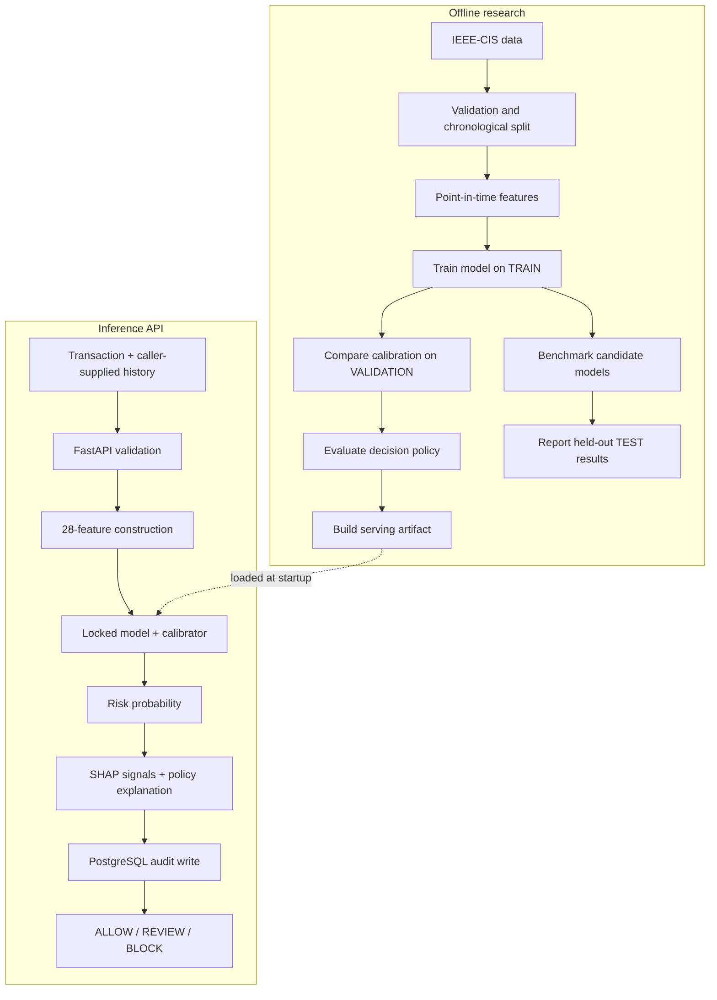

# RiskForge

[](https://github.com/Sujeet-Kona/RiskForge/actions/workflows/ci.yml)

RiskForge is an offline fraud-risk scoring project built with the IEEE-CIS Fraud Detection dataset. It combines point-in-time behavioral features, chronological model evaluation, probability calibration, a three-action decision policy, local explanations, a FastAPI inference service, and PostgreSQL decision records.

It is an engineering and ML research project. It is not a deployed payment-network fraud system.

## What it does

For a transaction and the strictly earlier history supplied by the caller, RiskForge:

1. Builds the shared 28-feature input.
2. Scores the transaction with a fitted XGBoost pipeline.
3. Applies an offline-fitted isotonic calibrator.
4. Applies the frozen `policy-001` thresholds and returns `ALLOW`, `REVIEW`, or `BLOCK`.
5. Returns model-signal reason codes separately from the policy explanation.
6. Writes the decision to PostgreSQL before returning a successful response.

The API does not maintain transaction history. The caller must provide the relevant prior history with each request.

## Architecture

Offline model development and online inference are separate. Training, calibration, policy evaluation, and artifact creation happen offline. The API loads the resulting artifact; it does not train or fit a model during a request.



## Key engineering decisions

- **Temporal correctness:** behavioral features use only transactions with an earlier `TransactionDT`; equal timestamps do not see one another.
- **Chronological evaluation:** TRAIN, VALIDATION, and TEST are time-ordered. Equal timestamps stay in the same partition.
- **Leakage control:** preprocessing and estimators are fitted on TRAIN. Calibration and policy research use VALIDATION. TEST is reserved for final reporting.
- **Separate score and action:** the calibrated probability is distinct from the policy that maps it to ALLOW, REVIEW, or BLOCK.
- **Separate explanations:** SHAP describes model contributions; the policy explanation describes why a probability falls in a decision band.
- **Serving discipline:** the API loads a versioned artifact and persists a decision before returning success.

## Evaluation snapshot

The dataset contains 590,540 transactions. The modeling frame uses 28 features and a chronological split:

| Partition | Rows |
| --- | ---: |
| TRAIN | 414,446 |
| VALIDATION | 88,013 |
| TEST | 88,081 |

Held-out TEST results for the three-model benchmark:

| Model | Average Precision | ROC-AUC |
| --- | ---: | ---: |
| Logistic Regression | 0.145789 | 0.780255 |
| Random Forest | 0.426033 | 0.861220 |
| XGBoost | **0.449254** | **0.865318** |

Isotonic calibration was selected using forward-chaining VALIDATION predictions and the preselected Brier-score criterion. On TEST, the calibrated XGBoost model recorded AP 0.438919, ROC-AUC 0.864850, Brier score 0.024204, log loss 0.102851, and ECE 0.003553. Calibration improved probability quality under the selected criterion but slightly reduced ranking metrics.

These are results on one public benchmark holdout, not estimates of live payment performance. The [evaluation report](docs/model-evaluation.md) contains the comparison, uncertainty analysis, and limitations.

## Run locally

Requirements: Python 3.12, PostgreSQL 17, and the IEEE-CIS dataset for offline model workflows.

```bash
python3.12 -m venv .venv
source .venv/bin/activate
python -m pip install --upgrade pip
python -m pip install -r requirements.txt
cp .env.example .env
docker compose up -d
.venv/bin/alembic upgrade head
```

Obtain the IEEE-CIS files from the Kaggle competition and place the source CSVs under `data/raw/ieee_cis/`. Dataset files and generated model artifacts are not committed.

Run the offline workflow from the repository root:

```bash
PYTHONPATH=. python scripts/inspect_dataset.py
PYTHONPATH=. python scripts/build_behavioral_features.py
PYTHONPATH=. python scripts/evaluate_calibration.py
PYTHONPATH=. python scripts/select_decision_policy.py
PYTHONPATH=. python scripts/build_serving_artifact.py
```

Start the API after the artifact has been built:

```bash
uvicorn app.main:app --reload
```

API documentation: http://127.0.0.1:8000/docs

A missing or invalid serving artifact causes the scoring endpoint to return `503`; the API does not train a replacement. See [system design](docs/system-design.md) for the request contract and persistence boundaries.

## Tests

With PostgreSQL running and the migration applied:

```bash
.venv/bin/python -m ruff check .
.venv/bin/python -m compileall -q .
.venv/bin/alembic upgrade head
.venv/bin/alembic check
RISKFORGE_REQUIRE_POSTGRES=1 .venv/bin/python -m pytest -q
```

CI runs lint, compilation, migration/schema checks, and tests against PostgreSQL 17. It does not download IEEE-CIS, train a model, build the serving artifact, run offline/API parity, or deploy the service.

## Limitations

- The benchmark is public historical data and represents one chronological holdout.
- Policy costs and review-effectiveness assumptions are synthetic project inputs.
- The active serving policy remains `policy-001` (review threshold 0.075, block threshold 0.110). A separately evaluated candidate has not been promoted.
- The API trusts caller-supplied history and cannot verify its completeness, freshness, authenticity, or entity association.
- Audit rows do not contain all prior-history records needed to replay a score. Append-only behavior is an application convention, not database-enforced immutability.
- Request idempotency and duplicate suppression are not implemented.
- Authentication, TLS termination, rate limiting, production deployment, drift monitoring, and a human-review operation are outside the current implementation.

## Documentation

- [Model evaluation](docs/model-evaluation.md) — benchmark, calibration, policy selection, and uncertainty.
- [System design](docs/system-design.md) — API, feature-history contract, explanations, audit persistence, and MLflow boundary.
- [Reproducibility and checks](docs/reproducibility.md) — data/artifact workflow, tests, CI scope, and parity verification.
