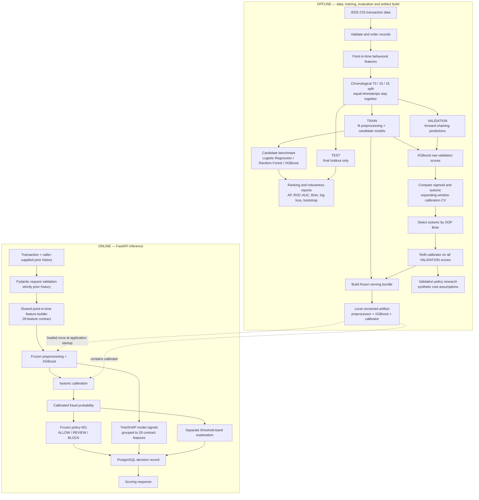

# RiskForge

[](https://github.com/Sujeet-Kona/RiskForge/actions/workflows/ci.yml)

**Fraud-risk modeling and transaction decisioning pipeline** built with Python, scikit-learn, XGBoost, FastAPI, and PostgreSQL.

RiskForge is an end-to-end ML engineering project built on the public IEEE-CIS Fraud Detection dataset. It constructs point-in-time behavioral features, evaluates fraud models on a chronological holdout, selects a probability calibrator using forward-chaining validation, maps calibrated risk to explicit decisions, and serves scored transactions with local explanations and PostgreSQL audit records.

> **Scope:** This is a research and portfolio system evaluated on historical public data. It is not deployed in a payment network, and its offline metrics do not establish live fraud performance.

---

## At a glance

| Item | Current implementation |
|---|---|
| Dataset | IEEE-CIS Fraud Detection |
| Transactions | 590,540 |
| Model input contract | 28 features: 13 behavioral, 4 categorical, 11 C/D |
| Temporal split | 414,446 TRAIN / 88,013 VALIDATION / 88,081 TEST |
| Selected estimator | XGBoost |
| Calibration | Isotonic regression, selected on forward-chaining VALIDATION predictions |
| Test Average Precision | 0.449254 raw / 0.438919 calibrated |
| Test ROC-AUC | 0.865318 raw / 0.864850 calibrated |
| Serving actions | ALLOW / REVIEW / BLOCK |
| API and audit | FastAPI + PostgreSQL |
| Experiment tracking | MLflow, offline only |

Average Precision (AP) is the primary ranking metric because fraud is rare in this dataset. It is often described informally as PR-AUC; the reported value is calculated with scikit-learn's `average_precision_score`.

## Architecture

RiskForge has two deliberately separated paths. The offline path creates and evaluates the model artifact. The online path loads that frozen artifact and scores one request; it does not train or tune anything.



### Architectural boundaries

- **One feature implementation:** offline feature generation and online request scoring both call `ml.features.behavioral.build_behavioral_features`; the API does not maintain a second rolling-feature algorithm.
- **No request-time training:** the service loads a frozen local artifact at startup. Missing, invalid, or incompatible artifacts cause scoring to fail rather than silently training or substituting a model.
- **No history store:** the caller supplies the prior transaction history. PostgreSQL stores completed decisions; it is not queried to construct behavioral features.
- **Separate explanations:** TreeSHAP describes model-level signals. The policy explanation describes the threshold band that produced the action.
- **MLflow is offline-only:** it tracks experiments and artifacts during model development; the inference request path does not call MLflow or a model registry.

## Data and temporal feature contract

The modeling frame contains **590,540 transactions and 28 model features**:

| Feature family | Count | Examples |
|---|---:|---|
| Behavioral | 13 | Amount transform, elapsed-time buckets, card/address 1-hour and 24-hour counts, history flags and 24-hour amount sums |
| Categorical | 4 | `ProductCD`, `card6`, `P_emaildomain`, `R_emaildomain` |
| C/D numeric | 11 | Selected `C*` and `D*` fields |
| **Total** | **28** | Locked model input contract |

The entity keys (`card1`, `addr1`, `addr2`) are used to construct history and are not model features. `TransactionDT` is retained for temporal ordering and splitting, not passed as a model feature.

### Point-in-time and leakage controls

The rolling behavioral implementation enforces the following:

- A transaction can use only events with `TransactionDT` strictly less than its own timestamp.
- Rows sharing a timestamp are scored as one group before any row in that group is inserted into history; they cannot see one another.
- The trailing 1-hour and 24-hour windows use an exclusive lower boundary.
- Input rows must be sorted by `TransactionDT`.
- The chronological split is made over distinct timestamp values, so tied timestamps are not divided across partitions.
- Preprocessing and estimators are fitted on TRAIN. Calibration and policy research use VALIDATION. TEST is held out for final reporting.

`TransactionDT` is treated as elapsed time, not an absolute calendar timestamp. The derived day-modulo feature is therefore a relative elapsed-time bucket, not a real-world weekday.

### Chronological partitions

| Partition | Transactions | Fraud cases | Fraud rate |
|---|---:|---:|---:|
| TRAIN | 414,446 | 14,588 | 3.52% |
| VALIDATION | 88,013 | 3,010 | 3.42% |
| TEST | 88,081 | 3,065 | 3.48% |
| **Total** | **590,540** | **20,663** | **3.50%** |

The split is chronological by distinct `TransactionDT` values (70% / 15% / 15% of distinct timestamps). Row counts can differ slightly from those exact percentages because timestamp groups remain intact.

## Model evaluation

### Candidate comparison on the held-out TEST partition

Each candidate's preprocessing and estimator are fitted on TRAIN only. The values below are the saved benchmark results from the same chronological split and 28-feature contract.

| Model | Average Precision | ROC-AUC | Brier score | Log loss |
|---|---:|---:|---:|---:|
| Logistic Regression | 0.145789 | 0.780255 | 0.178173 | 0.538330 |
| Random Forest | 0.426033 | 0.861220 | **0.077925** | **0.296063** |
| XGBoost | **0.449254** | **0.865318** | 0.101228 | 0.344462 |

XGBoost has the highest Average Precision and ROC-AUC in this benchmark. Random Forest has the better raw Brier score and log loss, so XGBoost should not be described as best on every metric.

**Saved benchmark evidence:** [model metrics CSV](reports/model_benchmark/model_metrics.csv) · [test segment metrics CSV](reports/model_benchmark/test_segment_metrics.csv) · [bootstrap intervals CSV](reports/model_benchmark/test_bootstrap_intervals.csv)

### Uncertainty around the XGBoost comparison

A paired, class-stratified percentile bootstrap with 500 replicates compared XGBoost with Random Forest on the same TEST transactions.

| Difference (XGBoost − Random Forest) | Estimate | 95% bootstrap interval |
|---|---:|---:|
| Average Precision | +0.023220 | +0.015090 to +0.030551 |
| ROC-AUC | +0.004098 | +0.001328 to +0.007241 |

These intervals quantify resampling uncertainty within this particular holdout. The bootstrap resamples transactions, not time blocks, and therefore does not account for temporal dependence, dataset shift, retraining variability, or threshold-selection uncertainty.

### Probability calibration

Calibration is selected separately from model ranking:

1. Fit XGBoost on TRAIN and generate raw scores for VALIDATION.
2. Divide VALIDATION into five chronological folds by distinct timestamps.
3. Treat the first fold as a warm-up period; score each later fold using a calibrator fitted only on earlier folds.
4. Compare sigmoid and isotonic calibration on the resulting 70,334 out-of-fold VALIDATION rows.
5. Select the method with the lower out-of-fold Brier score, then refit that calibrator on all VALIDATION scores for the serving artifact.
6. Evaluate the frozen calibrator once on TEST.

| Calibration method | Forward-chaining VALIDATION OOF Brier | OOF log loss |
|---|---:|---|
| Sigmoid | 0.025368 | Lower than isotonic |
| Isotonic | **0.024703** | Higher than sigmoid |

Isotonic was selected because Brier score was the predeclared selection criterion; it did not win every calibration metric.

### Raw versus calibrated XGBoost on TEST

| Metric | Raw XGBoost | Isotonic-calibrated XGBoost |
|---|---:|---:|
| Average Precision | 0.449254 | 0.438919 |
| ROC-AUC | 0.865318 | 0.864850 |
| Brier score | 0.101228 | **0.024204** |
| Log loss | 0.344462 | **0.102851** |
| Expected Calibration Error (10 equal-width bins) | See calibration run output | 0.003553 |

The Brier score fell by approximately **76.1%** on TEST (0.101228 to 0.024204). Calibration improves probability quality, not ranking: isotonic's stepwise mapping can create tied scores, which explains the small reduction in Average Precision and ROC-AUC. The raw TEST ECE is printed by the calibration script; no percentage ECE reduction is claimed in this README.

### Subgroup and temporal-slice analysis

The benchmark script also reports TEST results by four chronological slices, TRAIN-defined transaction-amount bands, `ProductCD`, and card-history groups. These are descriptive slices of the same holdout, not independent validation datasets. XGBoost led Average Precision in the four time slices, four amount bands, and three card-history groups, but not every `ProductCD` slice or every metric.

See [the saved segment report](reports/model_benchmark/test_segment_metrics.csv) for row counts, fraud counts, fraud rates, and metrics per segment.

## Calibration-to-decision policy

A calibrated probability and a business action are different outputs. The serving path applies the frozen `policy-001` thresholds:

| Action | Calibrated probability |
|---|---|
| ALLOW | (p < 0.075) |
| REVIEW | (0.075 \le p < 0.110) |
| BLOCK | (p \ge 0.110) |

Policy evaluation uses explicit synthetic assumptions: missed-fraud cost 100 units, false-decline cost 10 units, manual-review cost 5 units, and 70% assumed fraud capture by review. These values are experimental inputs, **not measured payment-network economics**. A candidate policy explored during validation was not promoted; the serving configuration remains `policy-001`.

The policy is amount-blind: it consumes the calibrated probability and does not scale costs by transaction amount. This is a project design choice, not a claim that real payment decisions should ignore amount.

## Online inference API

| Method | Path | Purpose |
|---|---|---|
| GET | `/health` | Reports service, loaded artifact identity, and database readiness |
| POST | `/v1/risk/score` | Scores one transaction using caller-supplied prior history |

The interactive API schema is available at `/docs` when the local service is running.

### Scoring request contract

The request contains:

- The transaction being scored.
- A `history` array containing prior records for the relevant `card1` and/or `(addr1, addr2)` entities.
- Optional `top_k` to control the number of returned reason signals (default 3).

History timestamps must be strictly earlier than the current transaction timestamp. Same-timestamp and future records are rejected rather than silently filtered. Only the trailing 24 hours can affect behavioral features. The API accepts at most 2,000 history records; larger requests are rejected rather than truncated.

### Artifact and decision flow

The service loads a local `joblib` artifact at startup. It contains the fitted preprocessing + XGBoost pipeline, isotonic calibrator, feature/model/policy identifiers, and guarded library-version metadata. The artifact is identified as `xgb-001` / `behavioral-v1`; these are local artifact identifiers, not entries in a model registry.

A scoring request follows this order:

1. Validate the transaction and supplied history with strict Pydantic schemas.
2. Build the 28-feature row using the shared point-in-time feature function.
3. Generate the raw XGBoost score and apply the frozen isotonic calibrator.
4. Apply `policy-001` to select ALLOW, REVIEW, or BLOCK.
5. Generate TreeSHAP model signals and a separate policy-threshold explanation.
6. Persist the decision record to PostgreSQL before returning a successful response.

If the serving artifact is missing, invalid, or incompatible with the installed scikit-learn/XGBoost versions, scoring is unavailable; the API does not train a fallback model. If the audit write fails, the service does not return a successful decision.

### Explanation semantics

TreeSHAP is calculated on the XGBoost raw output margin (log-odds). Contributions from transformed model columns are mapped back and summed to the original 28 contract features, including one-hot columns and missing indicators. The resulting reason codes are local model signals, **not causal explanations**. Their magnitudes are in raw-margin space, not calibrated-probability space.

The policy explanation is separate and states which calibrated-probability band produced the action. A strong model signal is not itself the reason a transaction was allowed, reviewed, or blocked.

### PostgreSQL audit boundary

Successful scoring records include transaction and decision details, reason signals, model/feature/policy identifiers, and relevant scoring metadata. The write is synchronous and must succeed before a successful response is returned.

The audit table is not a feature store: prior-history rows are not persisted, so an audit record alone cannot fully replay the original feature vector or score. Append-only behavior is an application convention, not database-enforced immutability. Request idempotency and duplicate suppression are not implemented.

## Technology stack

| Area | Technology |
|---|---|
| Language | Python 3.12 |
| Data processing | pandas, NumPy, PyArrow |
| Machine learning | scikit-learn, XGBoost |
| Calibration and evaluation | scikit-learn |
| Explainability | SHAP / TreeSHAP |
| API | FastAPI, Pydantic, Uvicorn |
| Database and migrations | PostgreSQL 17, SQLAlchemy, Alembic, psycopg |
| Experiment tracking | MLflow (offline only) |
| Testing and quality | pytest, Ruff |
| CI | GitHub Actions |
| Local database infrastructure | Docker Compose |

Docker Compose provisions PostgreSQL for local development. The FastAPI application is started from the host Python environment; the Compose file does not containerize or deploy the API.

## Repository layout

```text
RiskForge/
├── app/                  # FastAPI schemas, lifecycle, features and scoring service
├── db/                   # PostgreSQL models, sessions and audit repository
├── alembic/              # Database migrations
├── ml/
│   ├── data/             # Modeling frame and 28-feature contract
│   ├── features/         # Point-in-time behavioral feature construction
│   ├── split/            # Chronological split
│   └── models/           # Preprocessing, estimators, calibration and artifacts
├── policy/               # Locked decision policy and cost-sensitive evaluation
├── explain/              # TreeSHAP attribution and reason-code mapping
├── tracking/             # Offline MLflow tracking
├── scripts/              # Dataset, benchmark, calibration, policy and parity runs
├── tests/                # Unit, API, database and integration tests
├── reports/
│   └── model_benchmark/  # Saved benchmark, segment and bootstrap CSVs
└── docs/                 # Model evaluation, system design and reproducibility
```

## Run locally

### Requirements

- Python 3.12
- Docker with Docker Compose
- IEEE-CIS dataset files for offline training and evaluation

### Environment and database

```bash
git clone https://github.com/Sujeet-Kona/RiskForge.git
cd RiskForge

python3.12 -m venv .venv
source .venv/bin/activate
python -m pip install --upgrade pip
python -m pip install -r requirements.txt
python -m pip install ruff==0.17.3

cp .env.example .env
docker compose up -d
.venv/bin/alembic upgrade head
```

Download the IEEE-CIS Fraud Detection dataset through its Kaggle competition page and place the source CSV files under `data/raw/ieee_cis/`. The dataset, generated behavioral Parquet file, and fitted serving artifact are not committed.

### Build features and the serving artifact

Run from the repository root:

```bash
PYTHONPATH=. python scripts/inspect_dataset.py
PYTHONPATH=. python scripts/build_behavioral_features.py
PYTHONPATH=. python scripts/evaluate_calibration.py
PYTHONPATH=. python scripts/select_decision_policy.py
PYTHONPATH=. python scripts/build_serving_artifact.py
```

Run the three-model benchmark separately:

```bash
PYTHONPATH=. python scripts/run_model_benchmark.py
```

The benchmark writes `reports/model_benchmark/model_metrics.csv`, `test_segment_metrics.csv`, `test_bootstrap_intervals.csv`, and `run_metadata.json`.

### Start the API

```bash
uvicorn app.main:app --reload
```

Open [http://127.0.0.1:8000/docs](http://127.0.0.1:8000/docs) for the interactive API documentation.

The scoring endpoint returns an unavailable response if the serving artifact is missing or invalid. It never trains or calibrates a replacement during a request.

## Tests and verification

With PostgreSQL running and migrations applied:

```bash
.venv/bin/python -m ruff check .
.venv/bin/python -m compileall -q .
.venv/bin/alembic check
RISKFORGE_REQUIRE_POSTGRES=1 .venv/bin/python -m pytest -q
```

The same checks run in GitHub Actions against PostgreSQL 17. CI installs Ruff separately from `requirements.txt`.

### Offline-to-API parity

After building the serving artifact and preparing the dataset-derived behavioral file:

```bash
PYTHONPATH=. python scripts/verify_serving_parity.py
```

The recorded local verification on 2026-11-04 compared three real VALIDATION transactions: one ALLOW, one REVIEW, and one BLOCK. All 28 feature values matched between offline and API paths. Probabilities, decisions, reason codes, and policy explanations also matched. The largest absolute difference in the two floating-point amount-sum features was (1.310 \times 10^{-10}), within the (10^{-9}) absolute tolerance.

This is a targeted three-case parity check, not exhaustive proof for every possible input or caller-supplied history.

### CI scope

GitHub Actions runs Ruff, Python compilation, Alembic migration and schema checks, and pytest with PostgreSQL 17. CI does **not** download IEEE-CIS, train models, build the serving artifact, run the real-data parity script, connect to an MLflow server, or deploy the API.

## Limitations and non-goals

- Evaluation is based on one chronological holdout from a public historical dataset; it does not establish performance on current or future payment traffic.
- The bootstrap resamples transactions rather than temporal blocks and does not quantify uncertainty under time dependence or dataset shift.
- The API trusts caller-supplied history and cannot independently verify its completeness, freshness, authenticity, or entity association.
- Prior-history rows are not stored with audit records, so full score replay is not supported by the audit table alone.
- Append-only audit behavior is an application convention, not database-enforced immutability.
- Request idempotency and duplicate suppression are not implemented.
- Decision-policy costs and review-effectiveness assumptions are synthetic project inputs, not measured financial-industry economics.
- Authentication, TLS termination, rate limiting, production deployment, drift monitoring, continuous retraining, and a human-review operation are outside the current implementation.

---

## Further documentation

- [Model evaluation](docs/model-evaluation.md) — benchmark methodology, calibration selection, policy research, subgroup analysis, and uncertainty.
- [System design](docs/system-design.md) — inference flow, feature-history contract, explanations, audit persistence, and MLflow boundary.
- [Reproducibility](docs/reproducibility.md) — local workflows, test commands, CI scope, and offline/API parity.
